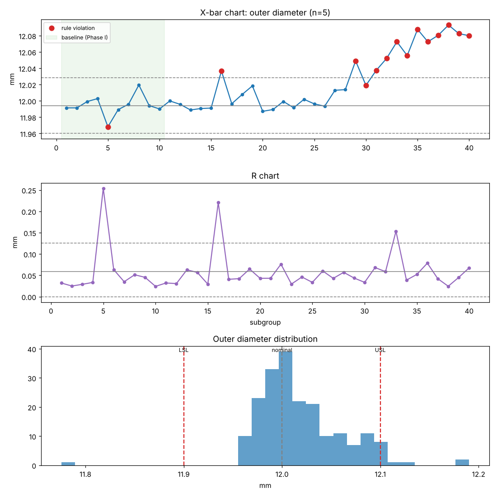
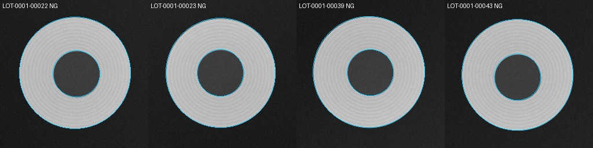

# Quality-inspection

**스마트 팩토리 방산부품 품질 검사** — 1인 프로젝트.
정밀 가공 부품(예시: 탄피 바닥면)의 **비전 검사 → 합/불 판정 → 공정 관리(SPC) → 추적성(DB·감사 체인) → 설비 연동(API·MQTT·대시보드) → 품질 표준(샘플링·검사 기준서) → 폐쇄망 배포**까지를 하나의 Python 패키지 `qinspect`로 구현했습니다.

> 실제 방산 도면·영상은 보안 대상이므로, 정답(ground truth)이 정확히 알려진 **합성 이미지**로 전 구간을 검증합니다.
> `PartSpec`의 모든 치수·공차·등급 기준은 가상의 예시 값입니다. 실제 사진은 `qinspect import` / `calibrate` / `anomaly-eval` 로 바로 넣을 수 있습니다.




## 한 줄 실행

```bash
pip install -e ".[dev]"
qinspect demo --out runs/demo        # 생성 → 이상탐지 학습 → 하이브리드 검사 → Gage R&R → 검사 기준서 (약 1분)
pytest                               # 44개 테스트
```

`runs/demo/` 에 `results.csv`, `summary.json`, `spc_outer_diameter.png`, `overlays/`, `qinspect.db`(감사 체인 포함), `anomaly_model.npz`, `gage_rr.json`, `inspection_standard.md` 가 생깁니다.

### 데모 결과 (200개, seed 0)

| 지표 | 값 |
|---|---|
| 판정 정확도 / 유출 / 과검 | **100 % / 0 / 0** (가드밴드·하이브리드 규칙 적용 후) |
| 결함 유형·등급 분류 | 100 % / 100 % (경결함 14건은 PASS 처리 + 기록) |
| 외경 측정 오차 | σ 0.0033 mm, 최대 0.0063 mm (공차폭 0.2 mm) |
| 공구 마모 드리프트 | 규격 이탈 전 subgroup 5에서 관리도 첫 경보 |
| Gage R&R (%GRR/공차) | 외경 8.6 % 양호, 포켓 18.8 % 조건부 |
| 이상탐지 (양품 40장 학습) | 스크래치·찍힘 AUROC 1.0, 양품 오탐 0, 54 ms/장 |

## 구성

```
                 ┌──────────┐   ┌────────────┐   ┌──────────┐   ┌───────────┐
 camera/synth ──▶│ vision   │──▶│ inspector  │──▶│ db/audit │──▶│ api / bus │──▶ MES · 대시보드
                 │ 치수·결함 │   │ 가드밴드    │   │ 해시체인  │   │ FastAPI   │
                 └──────────┘   │ 등급·하이브리드│  └──────────┘   │ MQTT      │
                 ┌──────────┐   └────────────┘        │          └───────────┘
                 │ anomaly  │────────▲                 ▼
                 │ 메모리뱅크 │                      spc · sampling · specdoc
                 └──────────┘
```

| Phase | 모듈 | 내용 |
|---|---|---|
| 0 데이터 | `synth.py` | 가공 흔적·조명·노이즈, 스크래치/찍힘/pit, 치수 불량, 공구 마모 드리프트, 정답 CSV |
| 0 비전 | `vision.py` | 서브픽셀 외경·포켓·동심도, 무결함 모델 잔차 기반 결함 검출, 형상 분류 |
| 1 판정 | `spec.py` `inspector.py` | **가드밴드**(ISO 14253-1), **치명/중/경 등급**, 사유 코드, 프로그램 버전 기록 |
| 1 MSA | `msa.py` | **Gage R&R (ANOVA, AIAG)** — 재고정 조건을 "작업자"로 두고 %GRR, ndc 산출 |
| 2 실데이터 | `datasets.py` | 사진 폴더 import, 기준 게이지로 px/mm **교정**, **MVTec 레이아웃** 로더·평가 |
| 3 딥러닝식 | `anomaly.py` | **PatchCore 방식 메모리뱅크 이상탐지**(양품만 학습, 코어셋, kNN) + 하이브리드 판정 규칙 |
| 0 SPC | `spc.py` | X̄-R, Western Electric 1~4, Phase I/II 한계, Cp/Cpk/Pp/Ppk |
| 4 추적성 | `db.py` | SQLite, Lot/Serial, 결함 좌표, 규격·모델 해시, **SHA-256 해시 체인 감사 추적** |
| 4 연동 | `line.py` `api.py` `dashboard.py` | 라인 시뮬레이터(카메라→검사→DB→**MQTT**→알람), **FastAPI REST**, **Streamlit 대시보드** |
| 5 표준 | `sampling.py` `specdoc.py` | **KS Q ISO 2859-1** 1회 샘플링, **c=0(MIL-STD-1916 철학)**, OC 곡선, **검사 기준서 자동 생성** |
| 5 배포 | `Dockerfile` `docker-compose.yml` `scripts/` | 폐쇄망용 이미지/휠하우스, 헬스체크, 비루트 실행 |

## 명령어

```bash
qinspect generate --out data/lot1 --n 300 --seed 1          # 합성 Lot + ground_truth.csv
qinspect train-anomaly --images data/lot1/images --limit 40  # 양품으로 메모리뱅크 학습 → anomaly_model.npz
qinspect inspect --images data/lot1/images --truth data/lot1/ground_truth.csv \
                 --model anomaly_model.npz --db qinspect.db  # 하이브리드 검사 + DB 기록
qinspect gage --parts 10 --operators 3 --trials 3           # Gage R&R
qinspect run-line --n 300 --db qinspect.db --bus mqtt://localhost:1883 -v   # 라인 시뮬레이션 (bus 생략 시 메모리)
qinspect serve --db qinspect.db --port 8000                 # REST API  → /docs
qinspect dashboard --db qinspect.db                         # Streamlit
qinspect sampling --lot-size 1000 --aql 1.0 --defectives 1  # 샘플링 계획 + Lot 판정
qinspect specdoc --gage runs/demo/gage_rr.json --out 검사기준서.md
qinspect audit --db qinspect.db                             # 해시 체인 검증
qinspect import --src ~/photos --dst data/real              # 실제 사진 투입
qinspect calibrate --image data/real/images/IMP-00001.png --diameter-mm 12.0 --out spec_real.json
qinspect anomaly-eval --dataset ~/mvtec/metal_nut           # MVTec 형식 데이터셋 평가 (AUROC)
```

REST 예시:
```bash
curl -F file=@part.png -F lot_id=LOT-07 http://localhost:8000/inspect
curl http://localhost:8000/lots/LOT-07/summary   # 수율, 파레토, SPC 상태, Cpk
curl http://localhost:8000/audit/verify
```

## 설계 포인트

- **가드밴드**: 측정 불확도(σ≈0.003 mm)의 2배를 공차 안쪽으로 당겨 판정. v0.1에서 발생했던 경계 부품 유출(실제 12.1013 / 측정 12.0955)이 사라졌습니다.
- **하이브리드 판정 규칙**: 이상탐지는 *설명되지 않는* 이상에만 NG를 추가합니다. 전통 비전이 이미 찾은 경결함(pit)에 높은 점수가 나오면 등급 판정이 우선합니다. 이 규칙 전에는 과검 9건, 후에는 0건.
- **문서 = 코드**: 검사 기준서는 `PartSpec`에서 생성되므로 기계가 검사하는 값과 문서가 어긋날 수 없습니다. 규격 해시·모델 해시가 DB와 문서에 같이 남습니다.
- **감사 추적**: 각 검사 레코드는 이전 레코드 해시를 포함해 SHA-256으로 연결됩니다. 과거 기록 1건을 수정하면 `audit/verify`가 끊어진 지점을 알려줍니다 (테스트 포함).
- **의존성 최소화**: 비전·이상탐지가 numpy/scipy만으로 동작해 폐쇄망 설치가 쉽습니다. CNN 백본(anomalib PatchCore 등)은 `anomaly.patch_features` 한 함수만 바꾸면 됩니다.

## 한계와 다음 단계

- 모든 성능 수치는 **합성 데이터** 기준입니다. 실제 부품에서는 조명·표면 질감 때문에 임계값 재조정과 MSA 재실시가 필요합니다 (`docs/ROADMAP.md`).
- ISO 2859-1 표는 공개 마스터표를 옮긴 것으로, 계약상 판정에 쓰기 전 원문 표준과 대조하세요. MIL-STD-1916 고유 표(검증수준별)는 미구현이며 c=0 계산기로 대체했습니다.
- 대시보드는 SQLite 폴링 방식입니다. 다중 스테이션이면 PostgreSQL + 메시지 큐로 바꾸는 것이 맞습니다.

자세한 구조는 [docs/ARCHITECTURE.md](docs/ARCHITECTURE.md), 배포는 [docs/DEPLOY_OFFLINE.md](docs/DEPLOY_OFFLINE.md), 생성된 문서 예시는 [docs/inspection_standard_example.md](docs/inspection_standard_example.md).
